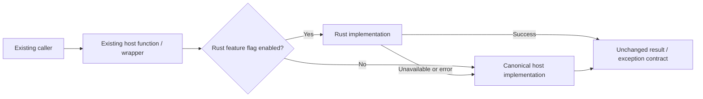

# Architecture Diagrams For Rust Migration

Use this reference before migration and after every accepted wave. Its purpose
is to verify that Rust remains an internal implementation swap behind the
existing host interface.

## Before migration

Produce a system/module diagram in Mermaid or C4 style showing:

- the existing caller and public host function signature;
- permissions, transaction, signal/event, ORM, Kafka, and network boundaries;
- the proposed wrapper and default-off feature flag;
- the canonical host implementation and Rust candidate;
- automatic fallback from unavailable/erroring Rust to the host path;
- plain-data ownership crossing the FFI/sidecar boundary.

Use the smallest diagram that makes these boundaries visible. Start with this
Mermaid template and adapt labels without changing the control flow:

Annotate the Rust edge with the binding type and plain input/output types. Do
not show Django request objects, ORM models, database handles, sessions, or
framework-managed entities crossing that edge.

## After each migration wave

Update the same diagram and compare it with the pre-migration version. Confirm:

- callers, public APIs, modules/services, permissions, transactions, signals,
  database ownership, and Kafka/network topology are unchanged;
- only the internal implementation choice and its feature-flag/fallback edge
  were added;
- the host implementation remains reachable for rollback;
- no Rust types or concepts leaked into business code.

If the updated diagram requires a structural change outside this boundary,
stop. Treat that work as a separate architecture decision requiring explicit
approval, not as part of the accelerator migration.
